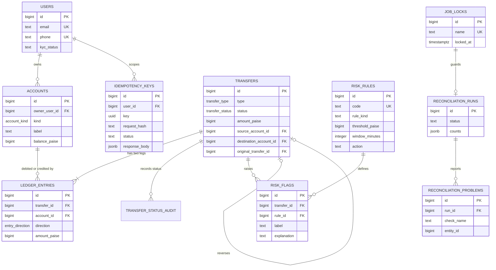

# Schema

## Nouns

| Noun | Meaning |
| --- | --- |
| **User** | A verified/pending KYC customer. Owns zero or more wallets. |
| **Wallet** | An `accounts` row with `kind = 'user_wallet'` and a non-null owner. `balance_paise` must stay >= 0. |
| **System account** | An `accounts` row with a null owner (`system_cash_in`, `system_cash_out`, `system_fee_revenue`). It may go negative because it represents an external counterparty. |
| **Transfer** | An intent to move money. Statuses: `pending`, `held`, `posted`, `reversed`, `failed`. |
| **Ledger entry** | An immutable debit or credit leg of a posted transfer. Every posted transfer has exactly one debit and one credit of equal amount. |
| **Status audit** | Append-only history of transfer status transitions. |
| **Idempotency key** | Client-supplied UUID scoped to a user; stores the first response for a POST body hash. |
| **Risk rule** | A DB-backed threshold (`amount`, `velocity`, `outflow`) and action (`hold`, `flag`). |
| **Risk flag** | A fired rule, optionally labelled and explained by the LLM. |
| **Reconciliation run** | One nightly or manual book check. |
| **Reconciliation problem** | A deduplicated corruption reported by a run. |
| **Job lock** | A named advisory-style row lock that prevents overlapping reconciliation runs. |

## Cardinality

- A **User** has `0..*` **Wallets**; each **Wallet** belongs to exactly `1` **User**.
- An **Account** has `0..*` **Ledger entries**; each **Ledger entry** belongs to exactly `1` **Account**.
- A **Transfer** has exactly `2` **Ledger entries** when posted; each **Ledger entry** belongs to exactly `1` **Transfer**.
- A **Transfer** may reverse `0..1` original **Transfer**; an original may have `0..1` reversal.
- A **Transfer** emits `0..*` **Status audits** and `0..*` **Risk flags**.
- A **Risk rule** fires `0..*` **Risk flags**.
- A **Reconciliation run** records `0..*` **Reconciliation problems**.
- An **Idempotency key** is unique per `(user_id, key)` and belongs to `0..1` **User**.

## Money and invariants

- All amounts are **whole paise in `BIGINT`**. No `FLOAT`, `DOUBLE`, or language-side decimal conversion is used for money.
- `accounts.balance_paise` is a fast cached value. The ledger is the source of truth; reconciliation compares the two.
- A partial CHECK keeps user wallets non-negative: `CHECK (owner_user_id IS NULL OR balance_paise >= 0)`. System accounts are allowed to go negative.
- `ledger_entries_immutable` rejects `UPDATE` and `DELETE` on posted entries.
- `ledger_entries_balance_check` is a deferred constraint trigger: at commit every transfer must have debits = credits = `transfer.amount_paise`.
- Reversals create a new transfer with `original_transfer_id` pointing at the original, then mark the original `reversed`. Ledger rows are never edited.
- Every `POST` requires a UUID `Idempotency-Key`; the `(user_id, key)` pair is unique and stores the first response (including business errors).
